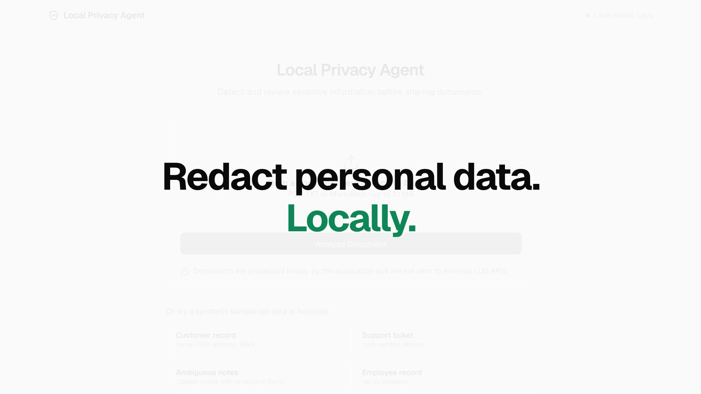
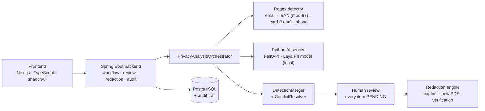

# Local Privacy Agent

[](LICENSE)


**Find, review and remove personal data from documents without sending them anywhere.**

Upload a PDF, TXT or Markdown file. Deterministic rules and a local machine-learning model (Laya)
flag possible personal data. A person approves or rejects every item, and the app generates a
verified, sanitised copy, with an audit trail of every step.

> How can deterministic privacy rules, local machine-learning inference and human review work
> together to make sensitive document handling safer?

```
Upload → Extract → Detect (rules + local model) → Merge → Human review → Redact → Verify → Export
```

---

## Why I built this

I wanted a small, end-to-end system to explore questions I find interesting in privacy engineering and
applied AI:

- **Local, privacy-aware AI.** Can a laptop-sized model do useful PII detection without the document
  ever leaving the machine?
- **Human-in-the-loop systems.** How should a UI present model output so a reviewer makes good
  decisions quickly, without being pushed to rubber-stamp everything?
- **Sensitive-data detection.** Where do deterministic rules beat a model, where does the model beat
  rules, and what happens when they disagree?
- **Agent-style orchestration.** Structuring a workflow as named, traceable tools, deterministic
  where correctness matters.
- **Honest evaluation.** Measuring the pipeline on labelled data instead of eyeballing demos.

It is a technical experiment inspired by real privacy tooling. It is not a clone of any commercial
product, and it is not a certified anonymisation system.

> **Status:** experimental and open source (Apache-2.0). Use synthetic documents only: see
> [Limitations](#limitations) before trying it on anything real.

## Demo

[](docs/media/demo.mp4)

*30-second silent overview ([MP4](docs/media/demo.mp4)). The full flow, using the ambiguous-notes sample:*

1. Upload the *ambiguous notes* sample: "Jordan works with Amazon in Berlin."
2. The processing screen runs through the stages live; the local Laya model does the heavy lifting.
3. Results: MEDIUM risk. Laya flags *Jordan*, *Georgia* and *Amber* as people and *Berlin* and
   *Victoria* as locations. *Amazon* and *Paris* are not flagged at all.
4. Review: approve the real names, reject the places, add *Amazon* as a manual redaction.
5. Generate: the output is verified, and the app warns that *Jordan* still appears twice elsewhere,
   un-redacted. One click fixes it.
6. Audit trail: every step, with values masked (`Jo•••• (6 chars)`).

## Architecture



| Component | Stack | Role |
|---|---|---|
| `backend/` | Java 21, Spring Boot 3.5, JPA, Flyway, PostgreSQL, PDFBox 3, springdoc | Workflow orchestrator: upload validation, text extraction, regex detection, merge, risk, review, redaction, audit, retention |
| `ai-service/` | Python 3.12, FastAPI, PyTorch (CPU), `laya` | Local PII inference behind a `PiiClassifier` abstraction |
| `frontend/` | Next.js 16, React 19, TypeScript, Tailwind 4, shadcn/ui (Base UI) | Upload, processing, results, review, output and audit screens |
| `evaluation/` | Python standard library | Labelled synthetic dataset and benchmark runner |

More detail, including the domain model, lifecycle state machine, merge algorithm and trade-offs, is in
[docs/ARCHITECTURE.md](docs/ARCHITECTURE.md). Design decisions are in [docs/DECISIONS.md](docs/DECISIONS.md).

### How Laya is used (and why the pipeline is hybrid)

The Laya PII flavour ([`goku-san/laya-experts`](https://huggingface.co/goku-san/laya-experts),
subfolder `pii`, Apache-2.0) is a **span classifier**, not a token tagger. A rule-based finder, vendored
verbatim from the model repository because the model only works on inputs shaped like its training data,
proposes candidate spans. Laya then assigns each one of 22 labels (`given name`, `surname`,
`email address`, …, `not pii`), using 400 characters of context on each side.

Laya has **no IBAN or organisation label** and is weaker at exact boundaries, while regexes can't find
names. So the backend runs both, merges overlapping hits into `HYBRID` detections, and flags
disagreements. In testing Laya labelled the card number `4111 1111 1111 1111` as a *tax number*; the
Luhn-validated rule kept it as a card and the UI asked the reviewer to check.

## Privacy approach

- **Local inference only.** Document text is processed inside the containers (on your machine, or on your own
  server for a [private deployment](#private-deployment-eg-railway)). It is never sent to
  OpenAI, Anthropic, Google or any other external API. The only outbound request is the one-time
  download of the model weights.
- **Synthetic data only.** Every sample and benchmark document is fictional and uses reserved ranges
  (`example.com`, drama phone numbers, published test card numbers, example IBANs).
- **Humans decide.** Nothing is redacted without an explicit approval. Bulk approval covers only
  high-confidence items recommended for redaction, and needs a confirmation. Confidence is shown as a
  signal ("97% · High") with a tooltip saying it is not certainty.
- **Real redaction.** Text is replaced before rendering. PDFs are rebuilt from scratch, so there is no
  hidden text layer under black boxes. Every export is re-read and verified before it is stored.
- **Auditability without a second copy of the data.** Every step is logged with masked values
  (`Ma•••••••••• (12 chars)`). Logs never contain document text.
- **Retention.** Files, extracted text, detections and audit trail are deleted after
  `PRIVACY_DOCUMENT_RETENTION_HOURS` (default 24) or on demand.

## Running locally

Requirements: Docker with **at least 6 GB of memory** available to containers (the model needs about
3 GB), and about 3 GB of disk.

```bash
git clone <this repo> local-privacy-agent && cd local-privacy-agent
cp .env.example .env        # optional, the defaults work
docker compose up --build
```

| URL | What |
|---|---|
| http://localhost:3000 | The app |
| http://localhost:8080/swagger-ui.html | Backend API (Swagger UI) |
| http://localhost:8000/docs | AI service API |
| http://localhost:8080/actuator/health | Health, including local model status |

On the **first start** the AI service downloads the Laya weights (~850 MB) into a Docker volume. The
header shows "Local model loading…" until it is ready; analyses started before that fail with
"Local PII model is currently unavailable." and can be retried.

**Speed.** On CPU inside Docker, Laya scored about 2 candidate spans per second in my tests (a short
document has 25 to 60 candidates, so 10 to 40 seconds). On Apple silicon you can run the AI service natively
on the GPU, which was roughly 10 times faster (35 spans in 2 s), and point the backend at it:

```bash
cd ai-service && uv sync --extra model && LAYA_DEVICE=mps uv run uvicorn app.main:app --port 8000
```

```bash
AI_SERVICE_URL=http://host.docker.internal:8000 docker compose up --build --no-deps postgres backend frontend
```

**Low-memory machines** can use the clearly labelled mock classifier (not a model; the header and every
analysis screen flag it): `PII_CLASSIFIER=mock docker compose up --build`.

### Tests

```bash
cd backend && ./mvnw test              # JUnit 5 + Testcontainers (needs Docker)
```

```bash
cd ai-service && uv sync --group dev && uv run pytest
```

```bash
cd frontend && npm ci && npm test && npm run lint && npm run typecheck
```

```bash
python3 -m unittest discover -s evaluation -p "test_*.py"
```

## Private deployment (e.g. Railway)

For a small private test (a handful of people, synthetic documents only). Only the frontend is public:

```
Browser ──HTTPS──▶ frontend (your subdomain)
                    ├─ src/proxy.ts: no valid session → /login (pages) or 401 (/api)
                    └─ /api/* ──private network + X-Internal-Token + X-User──▶ backend ──▶ ai-service
                                                                               └──▶ PostgreSQL
```

- **Sign-in:** named users from `APP_USERS` (scrypt hashes), a signed `HttpOnly`, `SameSite=Lax` session cookie
  (`Secure` over HTTPS), 8 h by default. Failed sign-ins are rate-limited; state-changing requests must be same-origin.
- **Backend:** with `SPRING_PROFILES_ACTIVE=prod` it refuses to start without `INTERNAL_API_TOKEN`, rejects any `/api`
  call without it, and turns off Swagger, the evaluation endpoint and detailed health output. The audit trail records
  which user did each step.
- **Headers:** CSP (same-origin only), `frame-ancestors 'none'`, `nosniff`, `no-referrer`, HSTS.

**Set up**

1. Create one hash per user (the password is read from a hidden prompt, 12+ characters):

   ```bash
   node frontend/scripts/hash-password.mjs alice
   ```

2. Generate the two secrets (`openssl rand -base64 48` for the session secret, `openssl rand -hex 32` for the token).
3. On Railway, create a PostgreSQL database and three services (Railway doesn't import `docker-compose.yml`). The
   frontend builds from the repository root; the backend and AI service build from their own folders
   (with GitHub sources, set each service's root directory; with the CLI, `railway up ./backend --path-as-root --service backend`):

   | Service | Dockerfile | Public domain | Variables |
   |---|---|---|---|
   | `frontend` | `frontend/Dockerfile` (repo root) | **yes** (your subdomain) | `APP_USERS`, `SESSION_SECRET`, `INTERNAL_API_TOKEN`, `BACKEND_URL=http://backend.railway.internal:8080` |
   | `backend` | `Dockerfile` (in `backend/`) | no | `SPRING_PROFILES_ACTIVE=prod`, `INTERNAL_API_TOKEN` (same value), `DATABASE_URL=jdbc:postgresql://${{Postgres.PGHOST}}:${{Postgres.PGPORT}}/${{Postgres.PGDATABASE}}`, `DATABASE_USER=${{Postgres.PGUSER}}`, `DATABASE_PASSWORD=${{Postgres.PGPASSWORD}}`, and `AI_SERVICE_URL=http://ai-service.railway.internal:8000` |
   | `ai-service` | `Dockerfile` (in `ai-service/`) | no | `LAYA_TORCH_THREADS` (about 2/3 of your vCPU quota, e.g. `16` on 24 vCPU) and `LAYA_BATCH_SIZE=32`; optionally `PII_CLASSIFIER=mock` on small plans (`UVICORN_HOST=::` only on an IPv6-only private network) |

   Give the backend a volume at `/data/documents` and the AI service a volume at `/models`, and set
   `RAILWAY_RUN_UID=0` on both (Railway mounts volumes as root). Don't add a TCP proxy to PostgreSQL.
   The backend binds to `::` in the `prod` profile, so it's reachable on IPv6-only private networks. The
   `*.railway.internal` hostnames follow your service names; adjust them if you name the services differently.
   The AI service logs its throughput after start-up (`Laya warm-up: … spans/s`); use it to tune `LAYA_TORCH_THREADS`.
   Without a limit, torch in a container uses the host's core count (48 on Railway) and gets throttled: 0.9 spans/s
   versus 4.8 spans/s with 16 threads.
4. After deploying, check: signed out, `https://<subdomain>/api/system/status` returns 401; the backend and AI
   service have no public URL; `/swagger-ui.html` is not reachable; the whole flow works after signing in.

**Capacity and cost** (Railway, 24 vCPU plan, measured). The upload page shows these live in "Capacity & cost":

| | Value | Why |
|---|---|---|
| Model speed | ~5 candidate spans/s (16 CPU threads) | CPU inference; the model scores every span the candidate finder proposes (~0.12 per character) |
| One page (~3,000 chars) | ~1 min 15 s, ~$0.01 compute | `spans ÷ speed` × (16 vCPU + 3.2 GB RAM) at Railway usage prices |
| Largest document | ~67k characters (~22 pages) with `AI_SERVICE_READ_TIMEOUT=30m`; ~22k with the default 10 min | One model call per document must finish within the backend's AI read timeout; the AI service also caps text at 200k characters |
| Files | 10 MB; PDF (text layer only), TXT, Markdown | Upload validation; no OCR |
| Concurrency | One document scored at a time; up to 50 queued | The model runs under a single lock (all CPU threads on one document); a long document delays everyone else's |
| Always-on cost | ~$40/month | Mostly the model held in memory (3.2 GB), whether or not anything is processed |
| Users | A handful, no roles | Env-based accounts, in-memory login rate limit, single frontend instance |

Estimates use `PRIVACY_COST_*` backend settings (Railway rates by default) and the model speed the AI service measures at
start-up. To go beyond these limits: split long documents into chunks and score them in parallel across replicas, or
reuse scores for repeated spans. A GPU would make it ~10× faster, but Railway doesn't offer one.

Never set `AUTH_DISABLED` on a hosted deployment. Rotating `SESSION_SECRET` signs everyone out, and removing a line from
`APP_USERS` revokes that user at their next request.

## Evaluation

`evaluation/run_evaluation.py` compares **Regex only**, **Laya only** and **Hybrid** on 14 hand-labelled
synthetic documents (forms, emails, a chat log, letters, meeting notes with deliberately ambiguous names
and places, an invoice, and a project update with no personal data). It calls the running backend, so
the numbers come from the production detectors and merger:

```bash
docker compose up -d && python3 evaluation/run_evaluation.py
```

<!-- RESULTS:START -->
Measured on 2026-09-28 with the real Laya model on CPU inside Docker (Apple M3 Pro host, 11 cores),
14 documents, 62 labelled entities. Redaction view: a prediction counts if it overlaps a labelled entity.

| Method | Precision | Recall | F1 | False pos. | False neg. | PII chars covered | Avg latency / doc |
|---|---:|---:|---:|---:|---:|---:|---:|
| Regex only | 100.0% | 40.3% | 0.575 | 0 | 37 | 47.8% | 1 ms |
| Laya only | 73.3% | 98.4% | 0.840 | 23 | 1 | 93.7% | 18.9 s |
| Hybrid (regex + Laya) | 73.3% | 100.0% | 0.846 | 23 | 0 | 99.0% | 19.1 s |

What the numbers say:

- **Rules alone are precise but blind.** Regex found every email, phone, IBAN and card number and nothing
  else, so it caught none of the names, addresses, ID numbers or dates of birth (40% recall).
- **Laya does the heavy lifting** (98.4% recall). Its one miss was `billing@example.org`, a role
  mailbox the model judged "not pii". That is arguably right, but the ground truth labels it, and the regex layer caught it.
  **Hybrid therefore reached 100% entity recall** and 99.0% character coverage (the rest is loose span boundaries).
- **The rules also fix categories.** Typed precision rises from 65.1% (Laya only) to 72.1% (hybrid), because
  checksum-validated IBAN and card types override Laya's look-alike labels (e.g. a card number read as a "tax number").
- **Precision is where the human comes in.** Of the 23 false positives, 16 are dates, years and place names
  (`12/03/2025`, `Frankfurt`, `Victoria`). Those categories are always marked "check context" and are excluded from bulk
  approval. The remaining 7 are genuine model errors such as order numbers read as postcodes and
  `Cedar` / `Iberia` read as names. This is exactly the review workload the UI is designed for.
- **Latency is the cost of running locally.** About 19 s per short document on Docker CPU,
  against about 1 ms for rules. The hybrid adds almost nothing on top of the model.

Caveat: this is a small, synthetic, English dataset, and Laya was itself trained on synthetic data. Read it as evidence
that the pipeline behaves as designed, not as a real-world accuracy claim.
<!-- RESULTS:END -->

Full tables, per-category recall and every false positive and negative are in
[evaluation/REPORT.md](evaluation/REPORT.md); raw data in `evaluation/results.json`. The labelling policy
(what counts as personal data and what is a decoy) is in [evaluation/dataset/README.md](evaluation/dataset/README.md).

## Limitations

- **Not a certified anonymisation system.** It helps a person find and remove personal data. It does
  not guarantee that a document is anonymous, and it does nothing about indirect identification from
  context.
- **Classifiers make mistakes, in both directions.** Laya misses things the candidate finder never
  proposes, mislabels look-alike numbers, flags places and first-name-like words, and was trained on
  synthetic English data. The regex rules are conservative and miss unusual formats.
- **Confidence is not certainty.** It is a calibrated model signal (or a fixed value for rules).
- **Human review is required.** That is the design, not a gap. A careless reviewer can still approve a
  bad result.
- **PDF output loses layout.** Redacted PDFs are rebuilt from extracted text: no images, tables or
  original fonts. Scanned PDFs (no text layer) are rejected, because there is no OCR. Characters
  outside the WinAnsi set show as `?` in PDF output.
- **BLOCK style reveals the length** of each redacted value; LABEL style does not.
- **English only**, evaluated on a small synthetic dataset. The numbers are a sanity check, not a
  benchmark.
- **Minimal access control.** A private deployment has sign-in for a handful of named users, but no roles,
  no per-user document isolation and no MFA: every signed-in user can open any document whose link they have.
  Fine for private testing with synthetic documents, not for real personal data. Extracted text sits
  unencrypted in PostgreSQL for the retention window.
- **CPU latency.** Tens of seconds per page in Docker.

## Future work

- DOCX support (a new `DocumentParser`) and OCR for scanned PDFs
- Multilingual testing (Laya has a multilingual base checkpoint, but no multilingual PII flavour yet)
- Pseudonymisation (consistent fake replacements) as an alternative to redaction
- Configurable privacy policies (which categories to always, never or conditionally redact)
- Richer context-aware analysis, e.g. linking all mentions of the same person
- A local LLM for reviewer explanations and summaries, kept outside the correctness path
- Batch processing of document sets
- Layout-preserving PDF redaction (true content-stream editing) with the same verification step

## Repository layout

```
local-privacy-agent/
├── backend/        Spring Boot application (workflow, detection, review, redaction, audit)
├── ai-service/     FastAPI + Laya PII classifier (PiiClassifier / LayaPiiClassifier / MockPiiClassifier)
├── frontend/       Next.js application
├── evaluation/     dataset/, run_evaluation.py, results.json, REPORT.md
├── samples/        synthetic demo documents (+ make_sample_pdf.py)
├── docs/           ARCHITECTURE.md, DECISIONS.md
├── docker/         notes on the container setup
├── docker-compose.yml
├── .env.example
├── LICENSE, NOTICE          Apache-2.0 and third-party attributions
└── CONTRIBUTING.md, SECURITY.md
```

## Acknowledgements

- [Laya](https://huggingface.co/convaiinnovations/laya) by ConvAI Innovations, and the
  [Laya Experts PII flavour](https://huggingface.co/goku-san/laya-experts) (Apache-2.0). The candidate
  finder in `ai-service/app/classifiers/laya_candidates.py` is copied from that repository (see `ai-service/NOTICE`).
- Laya's PII training data comes from [ai4privacy OpenPII](https://huggingface.co/datasets/ai4privacy/pii-masking-openpii-1m) (CC-BY-4.0).

## Contributing

Contributions are welcome: bug reports, synthetic evaluation cases and detector improvements especially.
Read [CONTRIBUTING.md](CONTRIBUTING.md) first; the main rule is **synthetic data only**. Report security
issues privately as described in [SECURITY.md](SECURITY.md).

## License

[Apache License 2.0](LICENSE). Third-party code and model attributions are in [NOTICE](NOTICE).
The Laya model weights are downloaded at runtime under their own Apache-2.0 licence and are not
redistributed here.
