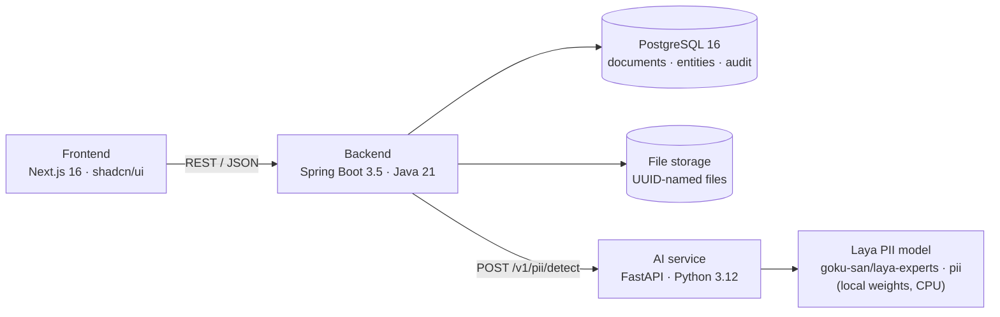
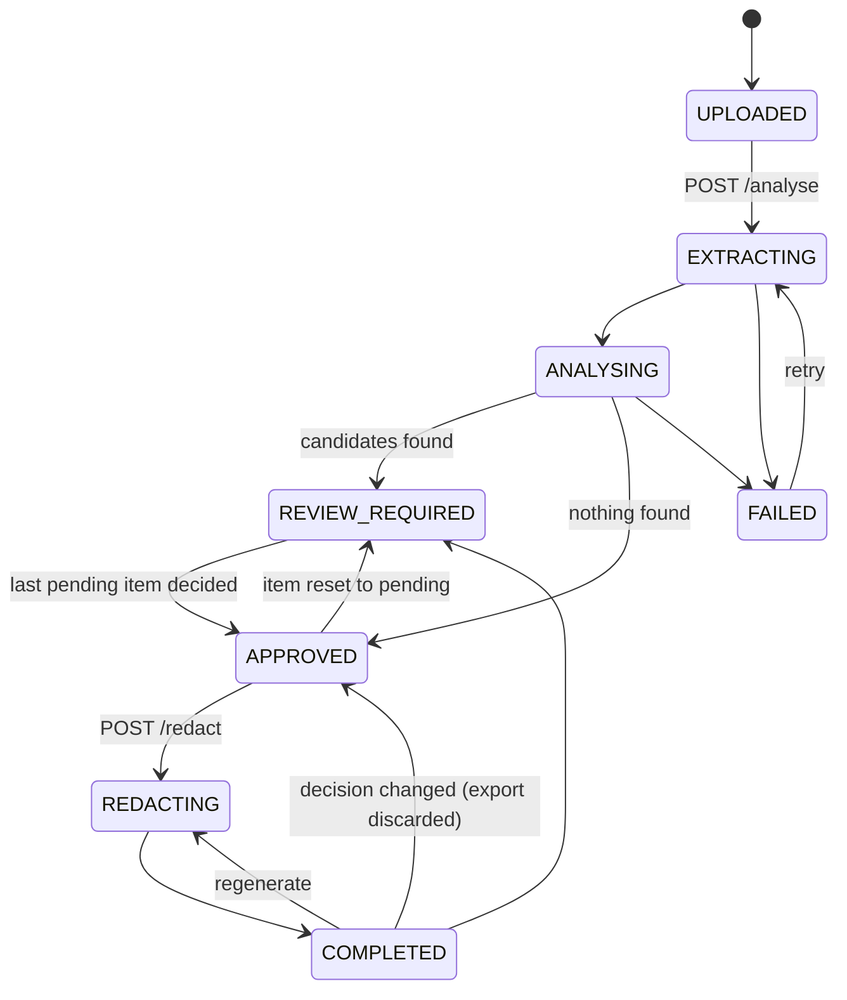
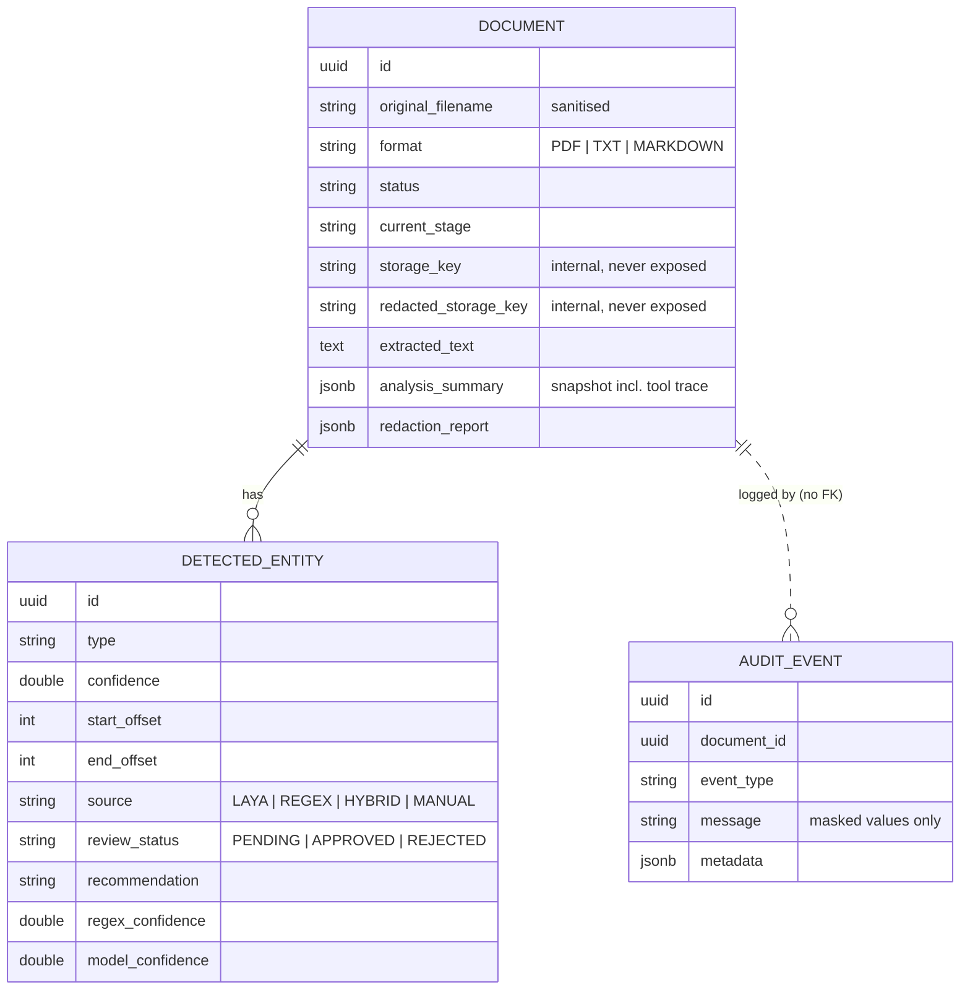
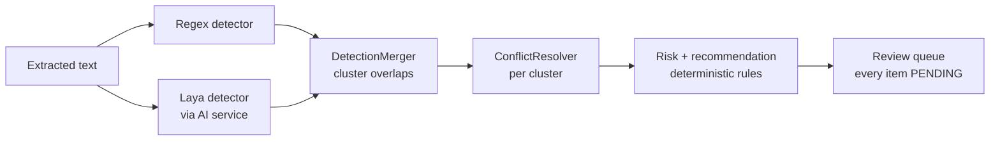
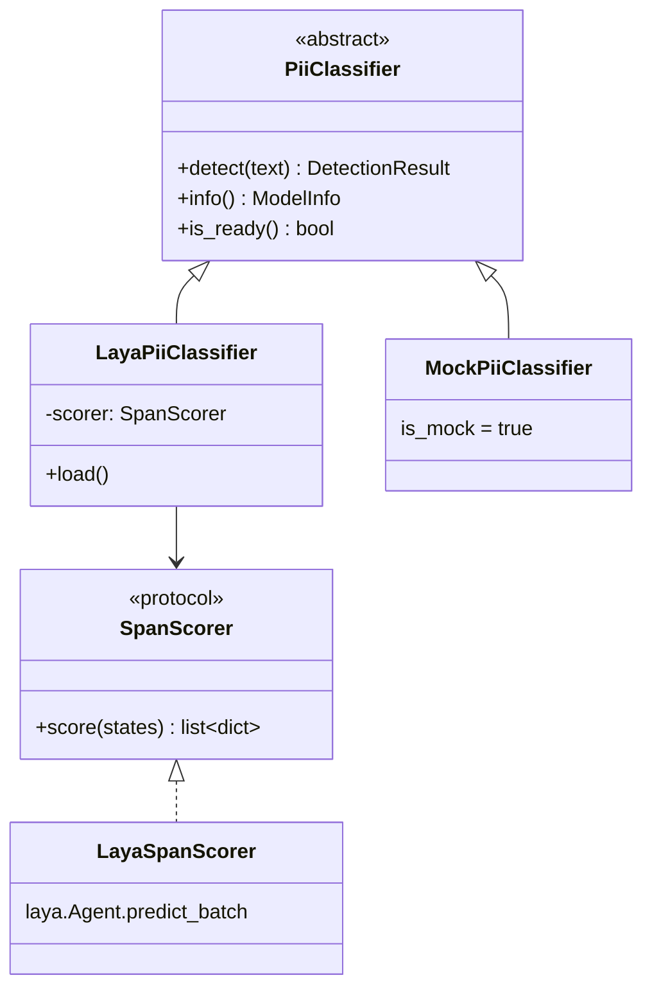

# Architecture

Local Privacy Agent is three services and a database, all started by `docker compose up --build`:



The browser only talks to the backend. The backend is the only component that talks to the AI
service. Document text never leaves these containers; the only outbound traffic is the one-time
download of the model weights from Hugging Face.

## Backend (Spring Boot)

The backend owns the workflow. Packages are organised by capability, not by technical layer:

| Package | Responsibility |
|---|---|
| `api` | Thin REST controllers and DTOs. No business logic; persistence entities never leave the service layer. |
| `document` | `Document` aggregate with its lifecycle state machine, upload validation, deletion. |
| `parsing` | `DocumentParser` interface with `PdfDocumentParser` (PDFBox), `TextDocumentParser`, `MarkdownDocumentParser`, selected by `DocumentParserRegistry`. DOCX = one new class plus an enum constant. |
| `storage` | `FileStorage` interface; `LocalFileStorage` with generated keys and a path-traversal guard. |
| `detection` | `RegexPiiDetector`, `ModelPiiDetector` + `AiServiceClient`, `DetectionMerger` + `ConflictResolver`. |
| `analysis` | `PrivacyAnalysisOrchestrator` (the agent), `PrivacyRiskCalculator`, `RecommendationPolicy`. |
| `review` | `DetectedEntity`, human review decisions, manual redactions. |
| `redaction` | `TextRedactor`, `PdfRedactedDocumentWriter`, `RedactionVerifier`, `RedactionService`. |
| `audit` | Append-only `AuditEvent` log with value masking. |
| `retention` | Scheduled deletion after `PRIVACY_DOCUMENT_RETENTION_HOURS`. |
| `evaluation` | Stateless detection endpoint used by the benchmark. |
| `common`, `config` | Structured errors, request ids, CORS, executor, OpenAPI. |

### Document lifecycle



Transitions are declared once in `DocumentStatus` and enforced by `Document.transitionTo`; anything
else is a `409 INVALID_WORKFLOW_STATE`. Redaction runs in one transaction: if generation or
verification fails, nothing is committed and the document stays `APPROVED` with all review decisions
intact (a failed export should not force a re-review). On startup, documents stuck in
`EXTRACTING`/`ANALYSING` (the analysis thread died with the process) are marked `FAILED` so they can be retried.

## Domain model



Audit events deliberately have no foreign key, so a `DOCUMENT_DELETED` / `DOCUMENT_EXPIRED` record can
outlive the document it describes.

## PII pipeline



### Regex detector

Conservative, validated rules for structured data only: email; IBAN (ISO 13616 mod-97 checksum);
payment cards (13-19 digits, plausible prefix, Luhn); phone numbers (international `+` prefix, trunk
`0` or US grouping, 8-15 digits, not part of a decimal or an ID). Rules run in priority order, and a
later rule never claims an overlapping span, so IBAN digits are not also a phone number.

### Laya detector

See *AI service* below. The backend does not trust the model output blindly: `ModelPiiDetector`
converts Python code-point offsets to Java UTF-16 indices and drops any entity whose offsets do not
reproduce its text or whose type is unknown (counted as `rejectedOutputs` in the summary).

### Merge algorithm (`DetectionMerger` + `ConflictResolver`)

1. Sort all detections by start (longest first on ties) and sweep left to right, grouping
   transitively overlapping detections into clusters.
2. For each cluster:
   - **Rule + model on the same span** (overlap at least half of the shorter span) become one
     `HYBRID` detection. The **rule's span and type win**, because rule boundaries are exact and
     checksums validate the type, while the Laya model card lists span boundaries as its weak point.
     - Same type: `confidence = 1 - (1 - c_rule)(1 - c_model)` (noisy-OR), capped at 0.999.
       Two largely independent detectors agreeing is stronger evidence than either alone.
     - Different type: a **type conflict**. Confidence stays at the rule's value (no boost), the
       entity is flagged, and the reviewer is told the detectors disagreed. This happens in practice:
       Laya labels the space-separated test card `4111 1111 1111 1111` as a *tax number*.
   - **Model only**: overlapping model detections are de-duplicated, keeping the most confident.
   - **Rule only**: kept as is.
   - A model detection that only marginally overlaps a rule match stays a separate candidate.
3. Output is sorted and never contains two detections with the same span. Remaining partial
   overlaps are safe because the redactor unions overlapping approved spans.

### Risk and recommendations (deterministic, no LLM)

`PrivacyRiskCalculator`, evaluated top-down:

| Level | Rule |
|---|---|
| HIGH | a sensitive identifier (IBAN, CREDIT_CARD, ID_NUMBER, DATE_OF_BIRTH) with confidence >= 0.70, or >= 15 detections |
| MEDIUM | a PERSON together with EMAIL/PHONE/ADDRESS, or >= 5 detections, or a low-confidence sensitive identifier |
| LOW | everything else, including no detections |

`RecommendationPolicy` suggests `REDACT`, `REVIEW` or `LIKELY_KEEP` per entity: type conflicts and
context-dependent categories (LOCATION, ORGANIZATION, OTHER) are always `REVIEW`, rule/hybrid matches
are `REDACT`, and model-only matches follow the confidence bands (>= 0.90 / 0.70-0.89 / < 0.70).
**Every entity starts `PENDING` regardless of the recommendation.** The confirmed "approve all high
confidence" action only covers `HIGH` + `REDACT` items.

## Agent layer

`PrivacyAnalysisOrchestrator` is an agent in the tool-using sense, with a fixed plan instead of an
LLM planner:

```
extract_document() -> detect_regex_pii() -> detect_model_pii() -> merge_detections()
                   -> calculate_privacy_risk() -> prepare_review_queue()
```

Each tool call is timed and recorded in a **tool trace** (stored in the analysis summary and shown
in the UI) and in the audit trail. The plan is deterministic on purpose: the same document always
goes through the same auditable steps, and there is no model deciding whether to skip a detector.
The design leaves room for a local LLM planner later (the tools already have narrow, typed contracts)
without making correctness depend on one now. The analysis runs on a small dedicated executor; each
step commits in its own short transaction so the processing screen can show live progress.

## AI service

FastAPI app exposing `POST /v1/pii/detect`, `GET /health` and `GET /model-info`.



**How Laya is actually used.** The Laya PII flavour ([`goku-san/laya-experts`](https://huggingface.co/goku-san/laya-experts),
subfolder `pii`, fine-tuned from [`convaiinnovations/laya`](https://huggingface.co/convaiinnovations/laya))
is a **span classifier**, not a token tagger. The model card and reference demo define a two-step process:

1. A rule-based candidate finder proposes every span that *could* be personal data (emails, numbers,
   dates, capitalised word runs and their sub-runs, gazetteers). It must be the exact finder used in
   training, so `app/classifiers/laya_candidates.py` is vendored verbatim from the model repo
   (Apache-2.0, see `ai-service/NOTICE`).
2. Each candidate becomes a state `{document_type, language, region, left, span, right}` (400
   characters of context on each side) and Laya picks one of 22 labels (`given name`, `surname`,
   `email address`, …, `not pii`). Scoring uses the public `laya.Agent.predict_batch` API, which
   returns the full label distribution.

The adapter then:

- keeps candidates with `P(pii) = 1 - P(not pii) >= threshold` (default 0.5);
- resolves nesting with the reference demo's rule: most confident label, then single words over
  multi-word runs, then longest; drops overlaps;
- **adds one guard** found during testing: a capitalised run that crosses a line break or a
  sentence-ending period (`"Berlin.\nWe"`) is never selected; titles (`Dr.`) are exempt;
- maps native labels to the app taxonomy (`labels.py`): given name + surname + title become one
  `PERSON`; street + building number + postcode (+ adjacent city) become one `ADDRESS`; a standalone
  city is `LOCATION`; a date is `DATE_OF_BIRTH` only after a birth cue ("born", "date of birth", "DOB"),
  otherwise `OTHER`.

Laya has **no IBAN and no organisation label**, which is one concrete reason the hybrid design
matters: IBANs come from the regex layer, and organisations are left to the human reviewer.

The model loads in a background thread on startup; until it is ready `/health` returns `503 loading`
and detection requests get a structured `503 MODEL_UNAVAILABLE`, which the backend turns into a
visible failure ("Local PII model is currently unavailable.") instead of a silent regex-only result.
`MockPiiClassifier` (`PII_CLASSIFIER=mock`) is a clearly labelled stand-in for tests and low-memory
machines; it reports `isMock: true` and the UI shows a warning banner whenever it was used.

## Redaction

- **Redaction happens on text, before any rendering.** `TextRedactor` replaces approved spans
  (overlaps unioned) with `█` per character (BLOCK style, line breaks kept) or `[REDACTED TYPE]`
  (LABEL style, hides length).
- **TXT / Markdown**: the redacted text is the output. Markdown is analysed as raw source, so offsets
  match the file and the output is still valid Markdown.
- **PDF**: a new PDF is rendered with PDFBox from the redacted text (A4, Helvetica, word wrap, page
  breaks). Redaction regions are drawn as filled black boxes with no text underneath. Nothing from the
  source PDF (content streams, fonts, images, annotations, metadata) is copied, so there is no hidden
  text layer to recover. The trade-off is that layout, images and tables are lost.
- **Verification**: `RedactionVerifier` re-reads the written bytes the way a recipient would (plain
  read, or PDF text extraction) and fails the export if any approved value appears more often than in
  the intended redacted text. It also reports *residuals*, approved values that still occur elsewhere
  un-redacted, and the UI offers "Redact remaining occurrences".

## Audit model

Every workflow step and decision appends an `AuditEvent` (`DOCUMENT_UPLOADED`, `TEXT_EXTRACTED`,
`REGEX_ANALYSIS_COMPLETED`, `MODEL_ANALYSIS_COMPLETED`, `DETECTIONS_MERGED`, `PII_DETECTED`,
`ENTITY_APPROVED/REJECTED/RESET/TYPE_CHANGED`, `BULK_APPROVED`, `MANUAL_ENTITY_ADDED`,
`REDACTION_STARTED/COMPLETED/WARNING`, `OUTPUT_INVALIDATED`, `EXPORT_CREATED`, `ERROR_OCCURRED`,
`DOCUMENT_DELETED/EXPIRED`). Messages carry counts, categories and **masked** values
(`Ma•••••••••• (12 chars)`), never document text, so the audit trail does not become a second copy of
the personal data. Deleting a document deletes its audit events and leaves a single deletion record
with counts only.

## Security and privacy trade-offs

| Concern | Choice |
|---|---|
| Data egress | No external LLM or API calls with document content. Only model weights are downloaded, once. |
| Logs | Request id, document id, stage, sizes, counts and durations only. Never text or values. The AI service logs character counts, not content. |
| Uploads | Extension whitelist, declared MIME vs extension check, content sniffing (PDF magic bytes, no NUL bytes in text), 10 MB limit, filename sanitisation. |
| Storage | Files stored under generated UUID keys; keys are validated by pattern and resolved paths must stay inside the storage root. Keys and paths never appear in API responses. |
| Retention | Everything about a document (files, text, detections, audit trail) is deleted after `PRIVACY_DOCUMENT_RETENTION_HOURS` (default 24) or on `DELETE /api/documents/{id}`. |
| Review | Nothing is redacted without a human decision; bulk approval requires explicit confirmation. |
| Authentication | **None.** This is a single-user local demo. Do not expose it on a network. |
| Extracted text at rest | Stored in PostgreSQL unencrypted for the retention window. Acceptable for a local demo; a real deployment would encrypt at rest and restrict DB access. |
